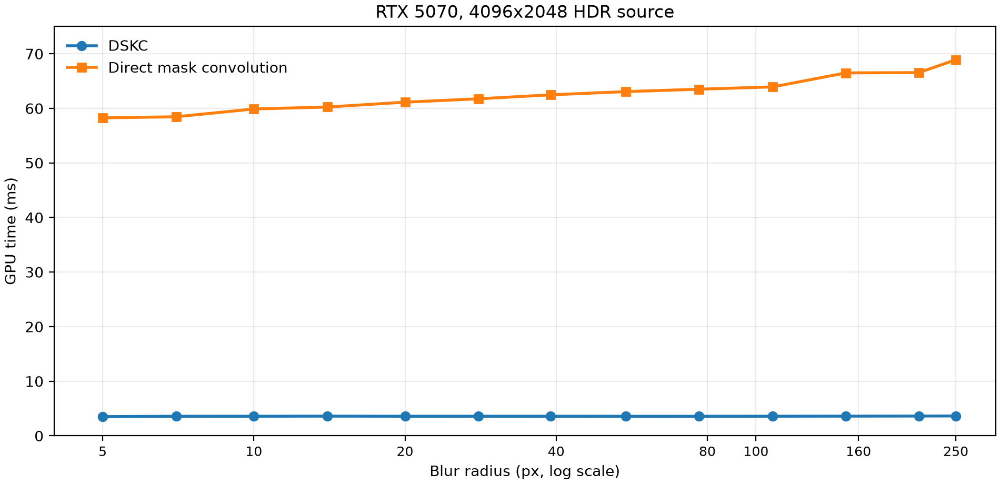
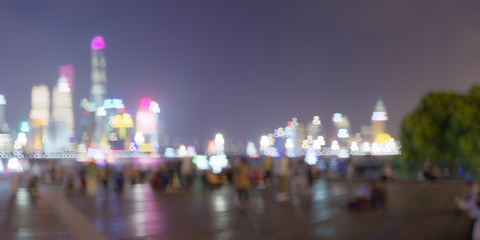
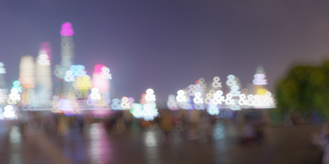
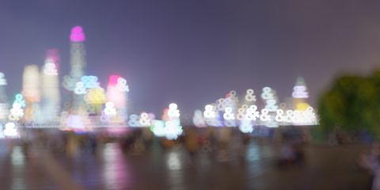
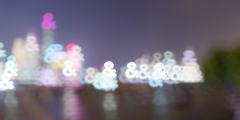
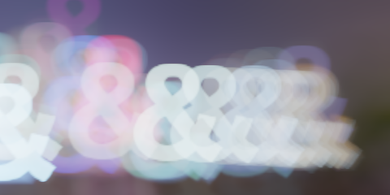

# DISK: Differentiable Sparse Kernel Complex

Dense convolution with large, arbitrary kernels is really expensive, which makes
it a poor fit for real-time applications like games, mobile UI, etc.
Differentiable Sparse Kernel Complex (Wu et al., 2026) replaces the dense kernel
with a cascade of sparse kernels. The offsets and weights are learned end-to-end
from the kernel's impulse response, and an ordered basis of filters is
interpolated at runtime, so the cost depends on the number of sparse taps instead
of the dense kernel size.

My contribution is an end-to-end implementation of the method. The PyTorch
trainer fits the sparse basis to Gaussian or custom stamp targets, and the D3D11
playground applies the learned LUT with filter-space interpolation. A direct
bokeh mask path is included so the result can be compared against a
straightforward aperture convolution.

The paper targets SDR. For HDR the playground filters in linear space and
tonemaps after the blur. The sparse weights are normalized, so the LUT itself
does not depend on the input range.

# AI Usage Declaration

I used Large Language Models (LLMs) to work through difficult optimization
problems, such as figuring out unstated implementation details from the paper.
One example was the step between the expanding rings used to initialize the
sparse layers. The paper defines the rings but not how to compute the step size
from the kernel support and layer count. I designed experiments that compared
step sizes against the target impulse response. The LLMs ran them and reported
the reconstruction error, and I used those results to choose a step that kept
the later layers from washing out the first-layer shape. Such code may appear on
development branches. All code on the main branch, except third-party code, is
written by me from scratch.

## Benchmark



Measured on an RTX 5070 at 4096x2048 with the ampersand aperture. DSKC stays near
3.6 ms from 5 to 250 px. The direct mask convolution rises from 58 to 69 ms as
the aperture grows. The x axis uses a log scale. The raw values come from the
playground benchmark export.

## Results

| Radius | DSKC | Direct mask |
| --- | --- | --- |
| 8 px |  |  |
| 16 px |  |  |
| 32 px |  |  |
| 64 px |  |  |
| 128 px |  |  |

A crop of `shanghai_bund_4k.hdr` with the same ampersand aperture. Obtained from
Poly Haven.

## Files of Interest

- `src/playground/playground.cpp` has the runtime. Grep for `@blur_impl`.
- `tools/dskc.py` trains the sparse basis LUT.
- `tools/bokeh.py` builds the direct mask LUT.
- `res/` holds the embedded LUTs and the stamp.

## Build

Install the Visual Studio 2022 Build Tools and the Windows SDK. Open an x64
Native Tools Command Prompt and run the following command.

```
build.bat playground release
```

The binary is `bin/playground.exe`. Leave out `release` for a debug build. The
build compiles the shaders and embeds the assets listed in
`src/playground/playground.embed`.

## Training the LUTs

Both LUTs are built offline with Python. Install the dependencies first.

```
py -m pip install numpy pillow torch
```

The DSKC trainer fits the ordered sparse basis to a Gaussian or a custom stamp.
The included LUT uses the ampersand stamp over a 1 to 250 px range. The two
numbers after the stamp are the minimum and maximum ink radius in pixels.

```
python tools/dskc.py --custom res/bokeh_ampersand.png 1 250 --out res/dskc_lut.bin
```

The bokeh trainer rasterizes a stamp into the mask the runtime samples.

```
python tools/bokeh.py res/bokeh_ampersand.png --out res/bokeh_lut.bin
```

The build embeds every file listed in `src/playground/playground.embed`. Write
the outputs to `res/dskc_lut.bin` and `res/bokeh_lut.bin`, then rerun the build.
